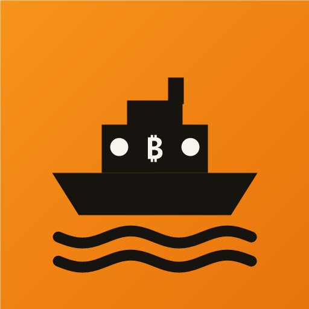
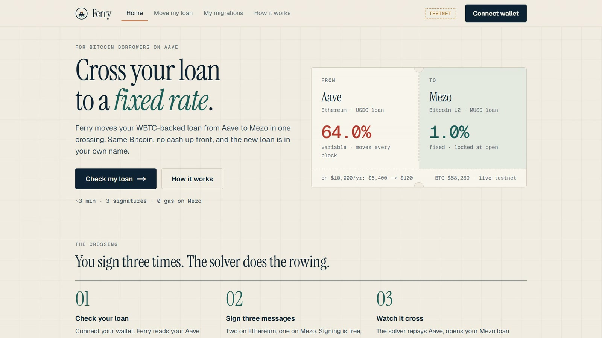
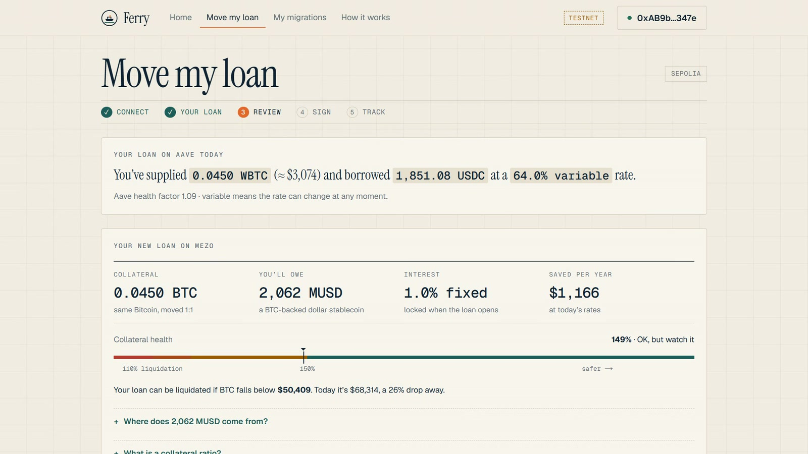
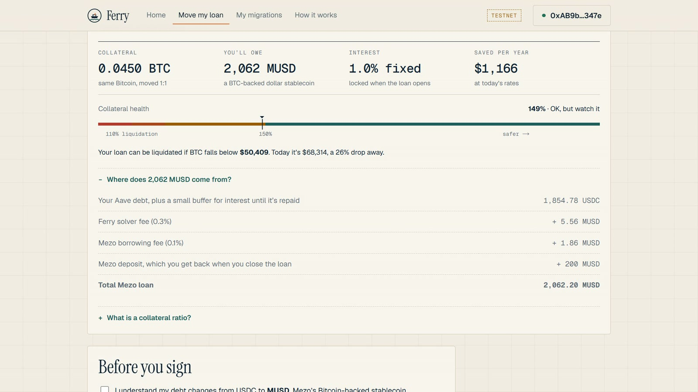
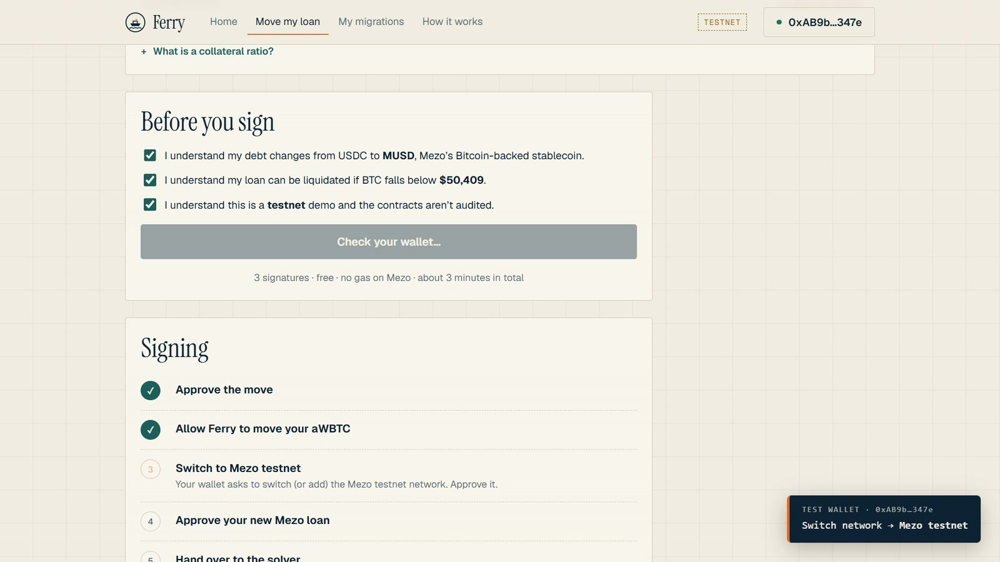
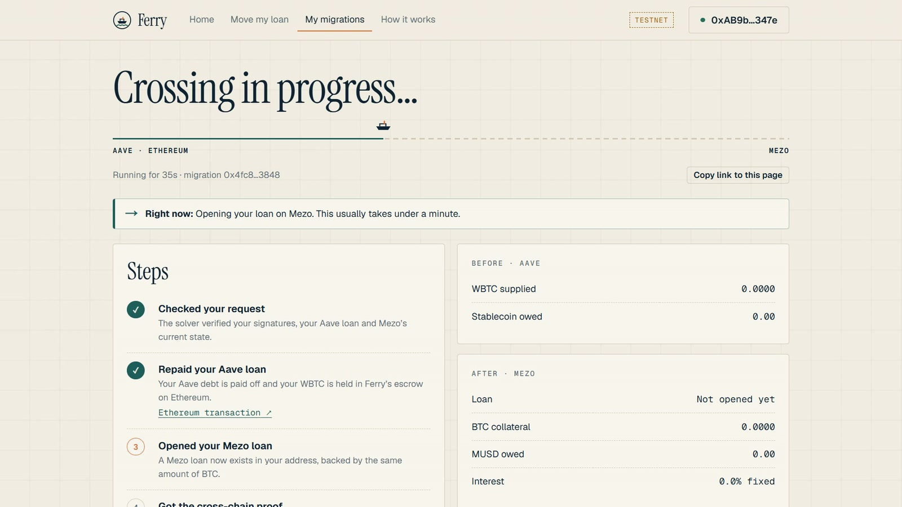
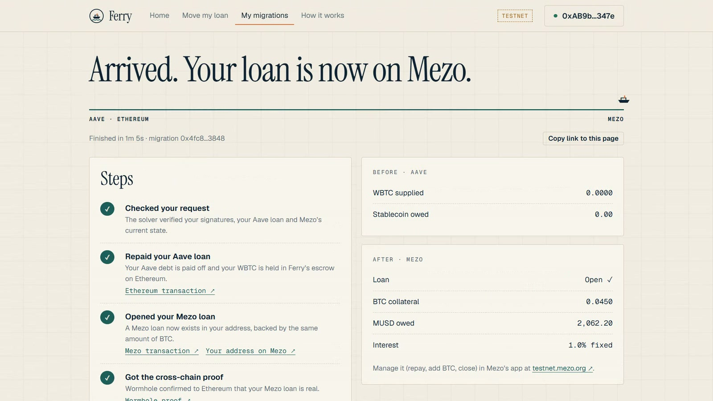

<p align="center">
  
</p>

<h1 align="center">Ferry</h1>

<p align="center">
  <b>Move your Bitcoin-backed loan from Aave to Mezo’s fixed-rate MUSD loan, in one flow.</b><br>
  <a href="https://ferry-kappa-three.vercel.app">Live demo (testnet)</a> ·
  <a href="docs/EVIDENCE.md">On-chain evidence</a> ·
  <a href="docs/ARCHITECTURE.md">Architecture</a> ·
  <a href="docs/SECURITY.md">Security</a>
</p>

<p align="center">
  
</p>

You have WBTC supplied on Aave with a variable-rate USDC/USDT loan against it. Variable rates swing; Mezo lends against
BTC at a **fixed** rate (1% promotional, 1–5% range). Moving by hand takes about five steps across two chains, and you need cash
to repay Aave first. Ferry's **solver fronts the money for both legs**. You sign messages and end with a **Mezo trove in
your own address**: same BTC as collateral, MUSD debt ≈ your old debt, fixed rate.

> **Testnet only** (Ethereum Sepolia + Mezo testnet), built for the Mezo Buildathon ("Build with MUSD and MEZO").
> Not audited. Never use with real funds.

- **How it works:** [docs/ARCHITECTURE.md](docs/ARCHITECTURE.md) (Mermaid sequence diagram)
- **Security model & risks:** [docs/SECURITY.md](docs/SECURITY.md)
- **On-chain evidence (every testnet tx):** [docs/EVIDENCE.md](docs/EVIDENCE.md)
- **Demo video script:** [docs/DEMO.md](docs/DEMO.md) · **Pitch deck outline:** [docs/DECK.md](docs/DECK.md)
- **Deploying (Vercel + Render/Railway):** [docs/DEPLOY.md](docs/DEPLOY.md)
- **Live demo (testnet):** https://ferry-kappa-three.vercel.app · solver API: https://ferry-1-5541.onrender.com/health
- **Preview any address (read-only):** `https://ferry-kappa-three.vercel.app/migrate?address=0x…`

## A real migration, start to finish

These screenshots are from one real testnet migration (intent `0x4fc8…3848`), completed in **62 seconds** including the
Wormhole proof. Every transaction is linked in [docs/EVIDENCE.md](docs/EVIDENCE.md).

| | |
|---|---|
| **1. Review your loan.** Ferry reads your Aave position live and shows the Mezo loan you would get: collateral, debt, fixed rate, yearly savings, collateral health and liquidation price. | **2. See every fee.** Solver fee, Mezo’s borrowing fee and the refundable deposit, itemised before you sign. |
|  |  |
| **3. Sign three free messages.** Intent and aWBTC permit on Sepolia, then Mezo’s own OpenTrove on Mezo testnet. No gas on Mezo. | **4. Watch it cross.** The solver repays Aave, opens your trove and settles; each step links to its transaction. |
|  |  |

<p align="center">
  <br>
  <i>Arrived: Aave position closed, Mezo loan open in the user’s own address (0.045 BTC, 2,062.20 MUSD, 1% fixed).</i>
</p>

## How it works (30 seconds)

1. **Sepolia:** you sign a migration intent (EIP-712) and a permit for your aWBTC. **Mezo:** you sign Mezo's own
   `OpenTrove` message with the exact BTC and MUSD amounts. You need no gas on Mezo.
2. **Sepolia (`FerryEscrow`):** the solver repays your Aave debt on your behalf; your WBTC moves into an escrow with no owner.
3. **Mezo (`FerryMezo`):** the solver's BTC opens your trove via `BorrowerOperationsSignatures.openTroveWithSignature`.
   The minted MUSD repays the solver, and a proof goes out over **Wormhole**.
4. **Sepolia:** the guardian-signed VAA releases the escrowed WBTC to the solver.
   If the Mezo leg never happens, a permissionless **timeout refund** gives the solver exactly what it repaid and **you keep the rest**.

## Testnet deployments

| Contract | Chain | Address |
|---|---|---|
| FerryEscrow (6 h timeout) | Sepolia | [`0x149089659d8320197acf6dc22033491343ec3afa`](https://sepolia.etherscan.io/address/0x149089659d8320197acf6dc22033491343ec3afa) |
| FerryEscrow (5 min, refund demo) | Sepolia | [`0xfdd2d414c28848e0818bc211013ef8319d5fd332`](https://sepolia.etherscan.io/address/0xfdd2d414c28848e0818bc211013ef8319d5fd332) |
| FerryMezo (with `republish`) | Mezo testnet (31611) | [`0x7f2e244e2325d299d9c261a1f09c044f8d559ec3`](https://explorer.test.mezo.org/address/0x7f2e244e2325d299d9c261a1f09c044f8d559ec3) |

v1 contracts (used for the M2–M4 evidence runs) are listed in [docs/EVIDENCE.md](docs/EVIDENCE.md).

Mezo MUSD system, Aave V3 Sepolia and Wormhole addresses: [shared/addresses.ts](shared/addresses.ts), all verified on chain by `npm run env-check`.

## Repository

```
contracts/   Hardhat 3: FerryEscrow (Sepolia), FerryMezo (Mezo), FerryTypes + Solidity unit/fuzz/invariant/reentrancy tests
solver/      TypeScript + viem: HTTP API, restart-safe state machine, milestone scripts (M0–M5), deploy, finalize
app/         Next.js + wagmi: live rate comparison, migration preview, multi-chain signing, status tracker, risks
shared/      addresses, ABIs, EIP-712 types, quote maths, chain readers (used by solver and app)
docs/        architecture, security, evidence, demo, deck
```

## Run it

Requirements: Node 24+, npm 11+.

```bash
npm install
cp .env.example .env          # testnet keys only (git-ignored)
npm run env-check             # M0: verifies every address, chain id, Mezo params, Wormhole cores (read-only)
npm run test:contracts        # 44 Solidity tests incl. fuzz + invariant
```

### Solver

```bash
npm run deploy -w solver      # FerryMezo on Mezo, FerryEscrow (+ short-timeout copy) + VaaVerifier on Sepolia → shared/deployments.json
npm start -w solver           # HTTP API on :8787  (GET /health /config /quote?user=  POST /intents  GET /intents/:id)
```

The solver wallet (`SOLVER_SEPOLIA_KEY` / `SOLVER_MEZO_KEY`) needs Sepolia ETH and Mezo testnet BTC
(≈ the user's WBTC amount per migration; [faucet](https://faucet.test.mezo.org)). Test USDC is minted from Aave's
permissionless Sepolia faucet automatically.

### App

```bash
cp app/.env.example app/.env.local
npm run dev:app               # http://localhost:3000
```

No Aave position? The Migrate page has a **"Create test Aave position"** button (Aave faucet → supply 0.045 WBTC → borrow 1,850 USDC).

### Milestone scripts (each prints explorer links)

| Script | Milestone |
|---|---|
| `npm run env-check` | M0 environment check |
| `npm run m1 -w solver` | M1 Mezo trove opened for a user via signature |
| `npm run m2 -w solver` | M2 FerryMezo → Wormhole → VAA verified on Sepolia |
| `npm run m3 -w solver` | M3 Aave repay-on-behalf + permit + withdraw into escrow |
| `npm run m4 -w solver` / `m4:refund` | M4 full migration / timeout refund |
| `npm run m5 -w solver` | M5 migration through the solver HTTP API |
| `npm run finalize -w solver -- <seq>` | finalize a pending migration once its VAA is signed |

## Mezo integration

- `BorrowerOperationsSignatures.openTroveWithSignature`: a third party funds a trove **owned by the user** (EIP-712 domain
  and `getNonce` read from source and verified on chain).
- Live reads of `PriceFeed`, `TroveManager.checkRecoveryMode` / `getTCR`, `BorrowerOperations.minNetDebt` / `borrowingRate`,
  `InterestRateManager.interestRate`; insert hints from `HintHelpers.getApproxHint` + `SortedTroves.findInsertPosition`.
- Trove read back on chain (`getTroveStatus`, `getTroveColl`, `getTroveDebt`) before paying the solver and attesting.
- Wormhole core messaging from Mezo (Wormhole chain id 50) to Ethereum.

## Roadmap

1. Morpho Blue (Base) and Aave on Base as sources.
2. Open solver network with bonded solvers.
3. Mainnet launch with deposit caps after an audit.
