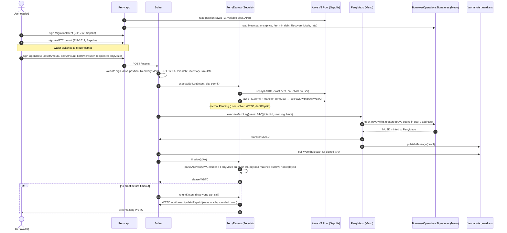

# Ferry architecture

Ferry moves a Bitcoin-backed loan from **Aave V3 (Ethereum)** to a **fixed-rate MUSD trove on Mezo**. A solver
fronts both legs; the user only signs messages. The user ends with a trove **in their own address**.

## Components

| Component | Where | Role |
|---|---|---|
| `FerryEscrow` | Ethereum Sepolia | Verifies the user's EIP-712 intent, repays Aave on the user's behalf with solver funds, pulls aWBTC via EIP-2612 permit, withdraws WBTC into escrow. Releases it to the solver only on a valid Wormhole VAA from `FerryMezo`; otherwise splits it after a timeout. No owner, no upgrades. |
| `FerryMezo` | Mezo testnet | Calls MUSD's `BorrowerOperationsSignatures.openTroveWithSignature` with the solver's BTC, checks the trove back in `TroveManager`, forwards the minted MUSD to the solver, publishes a proof through the Wormhole core contract. |
| `FerryTypes` | both | Intent struct + EIP-712 typehash, Wormhole payload codec (`version, intentId, user, troveColl, troveDebt, solver`). |
| Solver | Node (`solver/`) | Validates intents, runs both legs, fetches the VAA from Wormholescan, finalizes. Restart-safe state machine persisted to disk; HTTP API. |
| App | Next.js (`app/`) | Reads the Aave position and Mezo parameters live, previews the migration, collects the three signatures across two chains, tracks status. |
| `shared/` | TS | Addresses, ABIs, EIP-712 definitions, quote maths and chain readers used by both solver and app. |

## Sequence



## Why the Ethereum leg runs first

If the Mezo leg ran first, a user could take the trove and then close their Aave loan themselves, leaving the solver with
nothing to claim. With the escrow, the solver's repayment is secured by the user's own WBTC from the start. The user is
protected by the timeout: if the Mezo leg never happens, they get back all of their equity.

## Economics

```
Mezo debtAmount  = Aave debt × (1 + 0.2% interest buffer) × (1 + solver fee 0.30%)     → minted to the solver
Trove debt       = debtAmount + Mezo borrowing fee (0.1%) + 200 MUSD gas compensation  (returned on close)
Trove collateral = WBTC amount × 1e10 (1:1, 8 → 18 decimals)
Solver P&L       = + WBTC (Sepolia) + MUSD (Mezo) − USDC (Sepolia) − BTC (Mezo) ≈ + solver fee
```

Checks: Mezo net debt ≥ 1,800 MUSD; ICR ≥ 120% (hard), warning below 150% (CCR / Recovery Mode threshold).

## Key design decisions

- **Signature recipient = FerryMezo.** The user's Mezo signature names FerryMezo as MUSD recipient, so any solver can
  execute; the escrow always pays the solver that repaid Aave, so front-running the Mezo leg only costs the front-runner.
- **Exact repay amount.** Aave forbids `type(uint256).max` when repaying on behalf of someone else; the escrow reads the
  variable debt balance inside the same transaction and repays exactly that, bounded by the signed `maxDebtRepay`.
- **Full closure required.** `executeEthLeg` reverts unless the user's total Aave debt is zero afterwards (v1 migrates
  single-stablecoin positions), so the aWBTC transfer never fails a health-factor check.
- **Permit front-running tolerated.** The escrow `try`s the permit and then checks the allowance.
- **Replay protection.** Per-user intent nonces, intentId status, Mezo's own signature nonces, `executed[intentId]` on
  Mezo and consumed VAA hashes on Sepolia.
- **Republishable proofs.** FerryMezo stores each proof payload; `republish(intentId)` re-emits it if guardians missed the
  original observation (seen live on 2026-11-13). Duplicates are harmless: the escrow releases a Pending intent once.
  The solver republishes automatically when no signature arrives within 10 minutes (up to 3 times), then polls every
  published sequence and finalizes with whichever VAA is signed first.
- **Parallel intents, serialised transactions.** Each intent advances independently (waiting for a VAA never blocks
  other users); the solver's own transactions are serialised per chain with a mutex so it never races its own nonces.
- **USDC or USDT.** The app and solver detect which stablecoin the user owes; v1 rejects positions owing both.
- **Hints.** Computed right before the Mezo leg with `HintHelpers.getApproxHint` (15·√n trials) and
  `SortedTroves.findInsertPosition` — the live testnet has 330+ troves. The Mezo leg used 731k gas (block limit 10M).
- **RPC lag.** The public Sepolia endpoint is load-balanced; simulations and dependent writes are retried with backoff,
  Mezo reads are pinned to `latest`.

## Repository map

```
contracts/contracts/ethereum/FerryEscrow.sol   escrow, Aave leg, VAA finalize, timeout refund
contracts/contracts/mezo/FerryMezo.sol         trove via signature, MUSD to solver, Wormhole proof, republish
contracts/contracts/libraries/FerryTypes.sol   intent + payload
contracts/test/*.t.sol                         unit, fuzz, invariant, reentrancy (Hardhat 3 Solidity tests)
solver/src/                                    clients, legs, validation, state machine, store, HTTP server
solver/scripts/                                env-check (M0), m1…m5 milestone scripts, deploy, finalize
shared/                                        addresses, ABIs, EIP-712 types, quote maths, readers
app/                                           Next.js frontend
```
